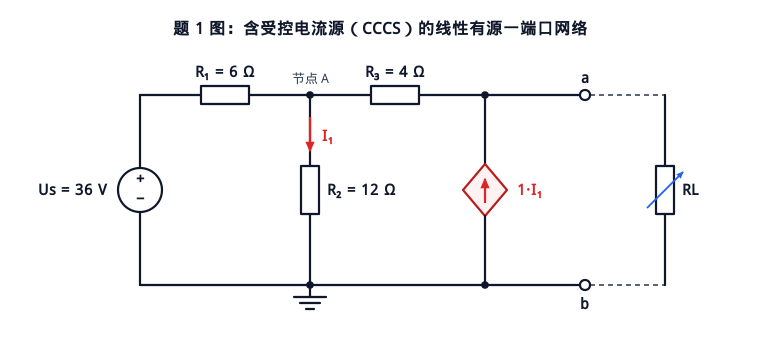
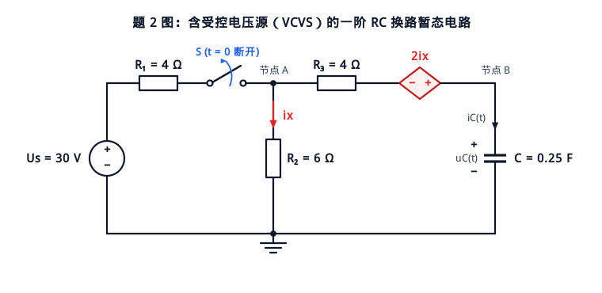
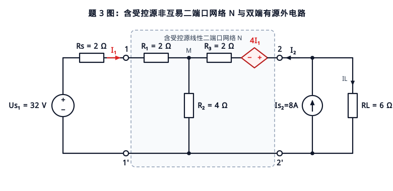

# 邱关源《电路》智能出题与配图 Agent (`setting-a-question`)

本项目针对理工科专业课（以经典教材**邱关源《电路》**为例）的智能出题与自动配图场景，提供了一套**四步闭环出题 Agent 架构**，并与传统的**单轮 Prompt 直接生成（Naive Baseline）**进行了实测对比。

---

## 一、为什么单轮 Prompt 出不出好题？（三大结构性病根）

在实际工程中，如果把考纲范围、难度梯度、陷阱要求与配图需求揉成一段单轮 Prompt 直接发给大模型：

> `stu_001, 出 3道题；难度比例：1：1：1；习题范围：普通的电阻电路分析、电路定理、二端口、正弦稳态电路、三相电路、耦合电路、谐振、周期非正弦、暂态（一阶电路、二阶电路）、滤波器、均匀传输线、图论；参考教材：邱关源《电路》；题目要求：简单题需≥2步计算、中等题含多考点+隐性陷阱、难题跨模块+概念误导+定理前提甄别，每个题目要带图；例如出电路定理支路上完全可以加受控源，而不是简单图`

单轮生成会稳定暴露出三个典型毛病（详见实测产物 [`examples/naive_single_prompt_output.md`](examples/naive_single_prompt_output.md)）：

1. **章节向低维纯电阻坍缩**：13 个章节写在一起时，大模型顺着概率最大、最省算力的路径走，永远挑第 1 章「电阻电路分析」（$12\text{ V}$ 直流源 + 三四个纯电阻串并联分压），不仅回避受控源、换路开关、非互易二端口，还会因为随手编参数导致解出 $\frac{180}{31}\text{ V}$、$\frac{72}{31}\text{ A}$ 这类教材里绝不会出现的怪异分数。
2. **画图能力反向锁死出题难度**：让大模型在输出题目时现场手写 ASCII 字符画或裸写 SVG 坐标，大模型既怕画菱形受控源（CCCS/VCVS）、开关动作弧线、耦合电感同名端把坐标画崩，又容易写出“导线直接穿过电阻把支路短路”、“文字与电线叠成一团”的废图，甚至因为手写冗长图形代码耗尽输出 Token 导致试卷半途截断。
3. **用低幼文字判断题糊弄“概念误导/定理甄别”**：当要求“难题含概念误导+定理前提甄别”时，单轮大模型不会设计定量计算陷阱，而是在最后一问硬塞一句*“某同学认为功率可以直接用叠加定理相加 $P = P_1 + P_2$，请问该同学的说法对不对？”*来应付差事，变成毫无区分度的送分题。

---

## 二、四步闭环架构设计

为了解决上述三大病根，本项目将「章节规划、数学验算与配图、题干编撰、红队审题」彻底解耦为四步闭环流水线：

```
[原始需求] 
    │
    ▼
Step 1: Planner (章节正交抽样与拓扑规划)
    │  强制跨章节抽样 1:1:1（第4章含受控源电路定理 / 第7章一阶RC换路暂态 / 第16章非互易二端口+第4章定理甄别）
    ▼
Step 2: Parameterized Topology + SymPy Solver + SVG/PNG Renderer (circuit_templates.py)
    │  ① SymPy 符号精确求解节点/端口方程，确保所有中间量与最终答案均为漂亮整数
    │  ② 精确计算“误将受控源置零”、“漏算开路支路VCVS电压”、“误用互易定理”、“功率直接相加”的错解对比值
    │  ③ 国标/邱关源教材风格 SVG 参数化绘图 + CairoSVG 高清 PNG 渲染，彻底解除画图对题目难度的锁死
    ▼
Step 3: Controlled Question & Solution Writer (agent.py + DeepSeek API)
    │  严格锚定 SymPy Ground-Truth 撰写教材级题干、定量陷阱设问与分步解析，严禁篡改数值或出低幼判断题
    ▼
Step 4: Red-Team Critic Loop (critic.py)
       硬规则（模块覆盖、高阶图元、反低幼问答正则、SymPy数值对齐）+ LLM 教研室主任深度评审，不达标自动打回重写
```

---

## 三、项目结构与快速运行

```text
.
├── agent.py                 # 四步闭环出题 Agent 主程序
├── circuit_templates.py     # 参数化电路拓扑 + SymPy 符号求解器 + 国标 SVG/PNG 渲染器
├── critic.py                # 教研主任红队自动审题器（硬规则 + LLM 评审）及 DeepSeek API 客户端
├── naive_baseline.py        # 单轮 Prompt 对照组实验脚本
├── README.md                # 项目说明文档
└── examples/                # 实跑输出产物目录
    ├── stu_001_exam.md              # 四步闭环 Agent 生成的 3 道真题与标准解析
    ├── q1.svg / q1.png              # 题1配图：含受控电流源（CCCS）的戴维南等效与最大功率传输网络
    ├── q2.svg / q2.png              # 题2配图：含受控电压源（VCVS）的一阶 RC 换路暂态电路
    ├── q3.svg / q3.png              # 题3配图：含受控源非互易二端口网络 N 与双端有源外电路
    ├── run_log.json                 # 完整运行日志（含 SymPy 验算值、Critic 评分与 Token 统计）
    └── naive_single_prompt_output.md # 单轮 Prompt 对照组原始输出与违规拦截记录
```

### 运行环境与指令

1. 配置环境变量（在项目根目录创建 `.env`，已被 `.gitignore` 忽略）：
   ```ini
   DEEPSEEK_API_KEY=your_api_key_here
   DEEPSEEK_BASE_URL=https://api.deepseek.com
   DEEPSEEK_MODEL=deepseek-chat
   ```
2. 运行单轮 Prompt 对照组实验：
   ```bash
   python3 naive_baseline.py
   ```
3. 运行四步闭环出题 Agent：
   ```bash
   python3 agent.py
   ```

---

## 四、`stu_001` 实测三道真题与配图预览

### 题 1（简单 ★）：第 4 章 电路定理 —— 含受控电流源（CCCS）的戴维南等效与最大功率传输
- **打破“简单题=纯电阻串并联”**：在简单题中直接引入菱形受控电流源 $1\cdot I_1$，考察≥3步核心计算。
- **SymPy 验算核心结论**：
  - 开路电压：$I_1(\text{oc}) = 3\text{ A},\ U_{\text{oc}} = 48\text{ V}$；
  - 短路电流与等效内阻：$I_1(\text{sc}) = 1\text{ A},\ I_{\text{sc}} = 4\text{ A},\ R_{\text{eq}} = \frac{U_{\text{oc}}}{I_{\text{sc}}} = 12\ \Omega$（若误将受控源置零开路，会算出错误值 $R_{\text{eq,wrong}} = (6 \parallel 12) + 4 = 8\ \Omega$）；
  - 最大功率传输：当 $R_L = R_{\text{eq}} = 12\ \Omega$ 时，$P_{\max} = \frac{U_{\text{oc}}^2}{4R_{\text{eq}}} = 48\text{ W}$。



### 题 2（中等 ★★）：第 7 章 一阶电路的时域分析 —— 含开关换路与受控电压源（VCVS）的 RC 暂态响应
- **多考点 + 双重定量隐性陷阱**：
  - **隐性陷阱 1（开路支路中的受控电压源不等于零）**：$t < 0$ 稳态时电容相当于开路，$R_3$ 无电流，但流过 $R_2$ 的电流 $i_x(0_-) = \frac{30}{4+6} = 3\text{ A}$，使得串联在电容支路上的受控电压源两端依然存在 $2i_x(0_-) = 6\text{ V}$ 电压！因此 $u_C(0_+) = u_C(0_-) = 18 + 6 = 24\text{ V}$（漏算受控源会误得 $18\text{ V}$）。
  - **隐性陷阱 2（受控源调制换路后的时间常数）**：$t \ge 0$ 开关 $S$ 断开后，从电容端口看进去的戴维南等效电阻为 $R_{\text{eq}} = R_2 + R_3 + 2 = 12\ \Omega$（误将受控源短路会算成 $10\ \Omega$），时间常数 $\tau = R_{\text{eq}}C = 12 \times 0.25 = 3\text{ s}$，全响应 $u_C(t) = 24e^{-t/3}\text{ V},\ i_C(t) = -2e^{-t/3}\text{ A}\ (t \ge 0)$。



### 题 3（困难 ★★★）：第 16 章 二端口网络 + 第 4 章 电路定理前提甄别
- **跨模块综合 + 将“定理前提甄别”彻底化为硬核数值计算**：
  - **互易定理失效甄别**：求得二端口开路阻抗矩阵 $\mathbf{Z} = \begin{bmatrix} 6 & 4 \\ 8 & 6 \end{bmatrix}\ \Omega$，由 $Z_{12} = 4\ \Omega \neq Z_{21} = 8\ \Omega$ 定量证明内部受控源 $4I_1$ 破坏了互易性（若盲目套用互易定理令 $Z_{21}=Z_{12}=4\ \Omega$，负载电压会从正确的 $36\text{ V}$ 算错为 $28.8\text{ V}$）。
  - **叠加定理与功率不可叠加的定量耦合项计算**：
    - 双源共同作用（$U_{s1}=32\text{ V},\ I_{s2}=8\text{ A}$）：$I_1 = 3\text{ A},\ I_2 = 2\text{ A},\ I_L = 6\text{ A},\ U_L = 36\text{ V}$，负载实际功率 $P_L = 216\text{ W}$；
    - 仅 $U_{s1}$ 作用：$I_L' = 4\text{ A},\ U_L' = 24\text{ V},\ P_L' = 96\text{ W}$；
    - 仅 $I_{s2}$ 作用：$I_L'' = 2\text{ A},\ U_L'' = 12\text{ V},\ P_L'' = 24\text{ W}$；
    - 定量差值：电流满足叠加（$I_L = 4 + 2 = 6\text{ A}$），但功率差值 $\Delta P = P_L - (P_L' + P_L'') = 216 - (96 + 24) = 96\text{ W}$，恰好等于交叉耦合功率项 $2 I_L' I_L'' R_L = 2 \times 4 \times 2 \times 6 = 96\text{ W}$。


